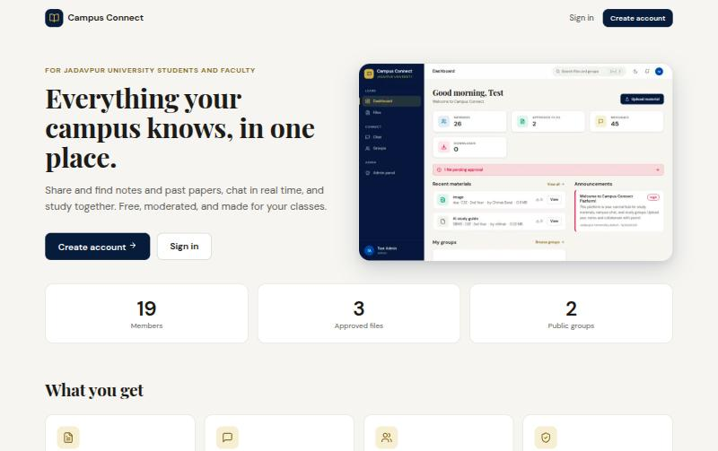
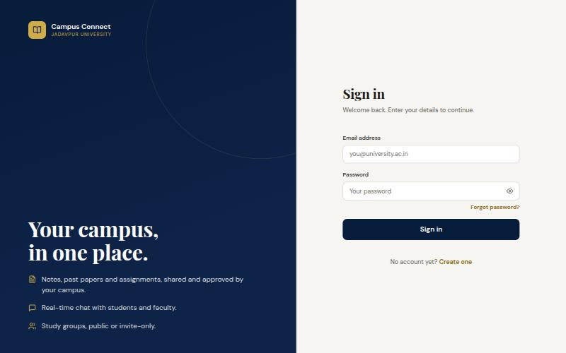
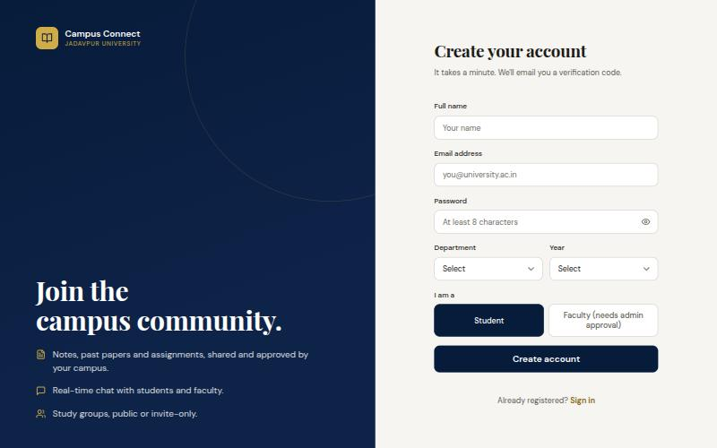
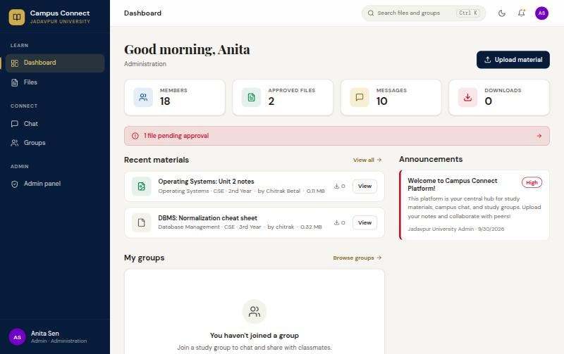
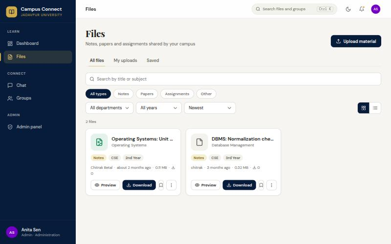
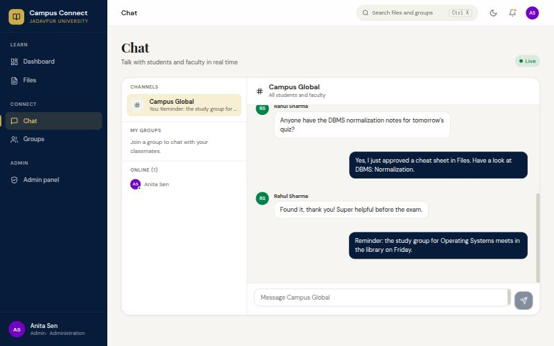
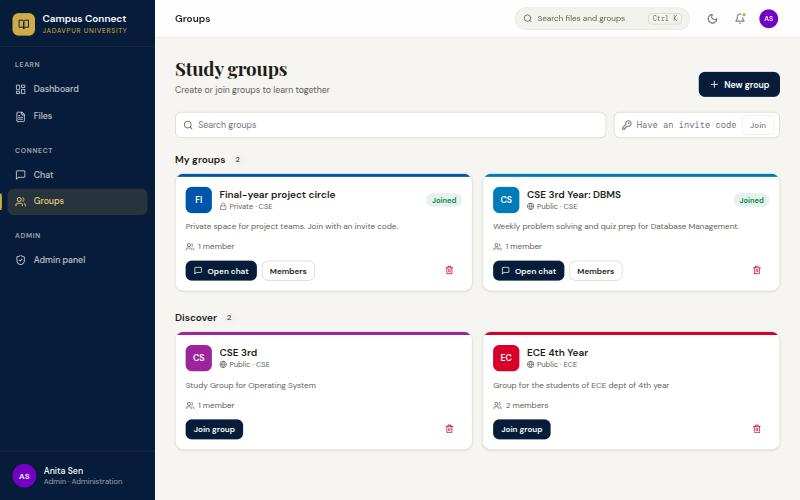
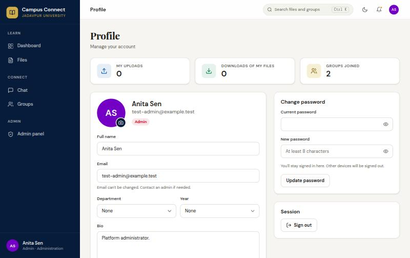
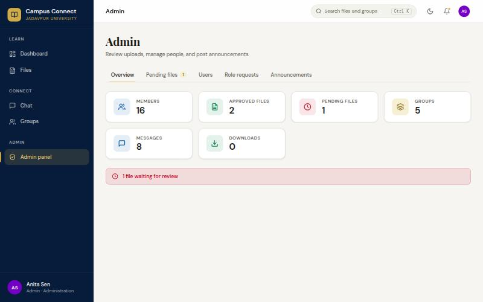

# Campus Connect

<p align="center">
  
</p>

<p align="center">
A campus collaboration platform: shared notes and past papers, real-time chat, and study groups.<br>
Built with <b>React</b>, <b>Express</b>, <b>PostgreSQL</b>, <b>Socket.IO</b> and <b>Cloudinary</b>.
</p>

<p align="center">


</p>

**Live demo:** https://campus-connect-five-zeta.vercel.app

> The backend runs on a free plan that sleeps when idle, so the first request after a quiet period can take up to a minute. The app shows a banner while it wakes up.

---

## Features

**Learning**
- Upload and browse notes, papers and assignments (PDF, Word, PowerPoint, images up to 50 MB)
- Admin moderation: student uploads stay pending until approved; faculty and admin uploads publish immediately
- In-browser preview for PDFs and images, download counts, saved files, "My uploads" with status
- Filters, sorting, grid/list view, and `Ctrl/Cmd + K` quick search across files and groups

**Connect**
- Real-time campus chat and per-group chat (Socket.IO): typing indicators, presence, unread badges, message history, delete
- Study groups, public or private with invite codes; group admins can remove members and rotate codes

**Accounts**
- Email OTP verification, forgot/reset password, change password (signs out other devices)
- Student accounts by default; **faculty is a request that an admin approves**
- Profile with avatar, bio, department and year

**Admin**
- Overview stats, pending file queue with preview, user management, faculty role requests, announcements

**Experience**
- Light and dark themes, responsive down to 375 px with a mobile tab bar, keyboard accessible (Lighthouse accessibility 100)

---

## Tech stack

| Layer | Technology |
|---|---|
| Frontend | React 18, Vite, React Router 6, Axios, Socket.IO client, plain CSS with design tokens |
| Backend | Node.js 20+, Express 4, Socket.IO, `pg`, zod, helmet |
| Database | PostgreSQL on Neon |
| Storage | Cloudinary |
| Email | Brevo transactional email (HTTPS API); nodemailer SMTP for local development |
| Hosting | Vercel (frontend), Render (backend) |

---

## Architecture

```
                 Browser
                    │
         React + Vite on Vercel
                    │  REST (Bearer JWT) + WebSocket
                    ▼
        Express + Socket.IO on Render
        ┌───────────┼─────────────┐
        ▼           ▼             ▼
   PostgreSQL   Cloudinary   Brevo (HTTPS)
     (Neon)    file storage   OTP / reset emails
```

Security-relevant design choices:
- JWTs carry a `token_version`; changing a password or deactivating a user invalidates older tokens.
- Group chat rooms are joined **only** from a server-side membership lookup, never from client input.
- Uploads must match an allow-list of extension *and* MIME type; files keep their extension in storage.
- OTPs are hashed, capped at 5 attempts, and single-use. See [SECURITY.md](SECURITY.md).

---

## Screenshots

<p align="center">
  
  
</p>

**Dashboard**

<p align="center"></p>

**Files** (filters, sorting, preview, saved files)

<p align="center"></p>

**Real-time chat**

<p align="center"></p>

**Study groups** (public and private)

<p align="center"></p>

**Profile and Admin**

<p align="center">
  
  
</p>

---

## Getting started

Requires **Node.js 20+**.

```bash
git clone https://github.com/chitrak-cs/Campus-Connect.git
cd Campus-Connect
```

### 1. Database (use a Neon branch, not production)

Create a Neon branch named `dev` from your production branch and use its connection string locally. Tables, indexes and migrations are created automatically (idempotently) when the backend starts.

### 2. Backend

```bash
cd backend
npm install
cp .env.example .env     # fill in the values (see the table below)
npm run dev              # http://localhost:5001
```

Optional: create a local admin account (refuses to run when `NODE_ENV=production`):

```bash
# set SEED_ADMIN_EMAIL and SEED_ADMIN_PASSWORD in backend/.env first
node seed.js
```

### 3. Frontend

```bash
cd frontend
npm install
cp .env.example .env     # VITE_API_URL=/api uses the Vite dev proxy
npm run dev              # http://localhost:5173
```

### 4. Tests and lint

```bash
cd backend
npm test                 # needs TEST_DATABASE_URI (the Neon dev branch). NEVER point it at production.
npm run lint

cd ../frontend
npm run lint
npm run build
```

The backend suite (`node:test` + supertest + socket.io-client) covers registration and role approval, login and OTP rules, private group isolation over live sockets, upload validation, admin safety rules, session invalidation, search and message ordering.

---

## Environment variables

**Backend (`backend/.env`)**

| Variable | Notes |
|---|---|
| `DATABASE_URI` | Neon connection string (locally: the `dev` branch) |
| `JWT_SECRET`, `JWT_EXPIRES_IN` | Signing secret; token lifetime (default `7d`) |
| `CLOUDINARY_CLOUD_NAME`, `CLOUDINARY_API_KEY`, `CLOUDINARY_API_SECRET` | File storage. In Cloudinary: Settings, Security, enable **PDF and ZIP files delivery**, or PDFs return 401 |
| `CLIENT_URLS` | Comma-separated allowed origins (falls back to `CLIENT_URL`) |
| `NODE_ENV` | `production` on the server |
| `BREVO_API_KEY`, `MAIL_FROM`, `MAIL_FROM_NAME` | Transactional email. In Brevo: verify the sender, and turn off *Authorized IPs* blocking for API keys (Render's IPs change) |
| `SMTP_HOST`, `SMTP_PORT`, `SMTP_USER`, `SMTP_PASS`, `SMTP_SECURE` | Local-only nodemailer fallback (Render's free plan blocks SMTP) |
| `ALLOWED_EMAIL_DOMAINS` | Optional, comma-separated. Empty allows any email |
| `ENABLE_RATE_LIMIT` | `true` turns on request rate limiting (off by default) |
| `FORCE_IPV4` | `true` only if HTTPS or Postgres connections stall ~15 s on your network |
| `SEED_ADMIN_EMAIL`, `SEED_ADMIN_PASSWORD` | Used only by `seed.js` |
| `TEST_DATABASE_URI` | Dev-branch URL for `npm test` |
| `PORT` | Set by Render; defaults to 5001 locally |

**Frontend (`frontend/.env`)**

| Variable | Notes |
|---|---|
| `VITE_API_URL` | Production: `https://<backend>/api`. Local: `/api` |
| `VITE_SOCKET_URL` | Optional; defaults to the origin of `VITE_API_URL` |

Never commit `.env` files.

---

## Project structure

```text
Campus-Connect/
├── backend/
│   ├── config/         db (schema + migrations), cloudinary, network
│   ├── controllers/    auth, files, groups, messages, admin
│   ├── middleware/     auth, validate (zod), rateLimit
│   ├── routes/         auth, files, groups, messages, admin, search, public
│   ├── socket/         real-time layer (auth, presence, chat)
│   ├── utils/          mailer, email templates
│   ├── validation/     zod schemas
│   ├── scripts/        cleanup-orphans, normalize-emails
│   ├── test/           smoke tests
│   └── server.js
├── frontend/
│   ├── public/         favicon, icons, theme-init.js
│   └── src/
│       ├── components/ Layout, CommandPalette, ui/ (design system), files/, chat/, groups/
│       ├── context/    Auth, Theme
│       ├── hooks/      notifications, countdown
│       ├── pages/      Landing, Login, Register, Dashboard, Files, Chat, Groups, Profile, Admin
│       ├── styles/     tokens, base, layout, components, pages/
│       └── utils/      api, socket, auth storage, formatting
└── README-assets/
```

---

## REST API (summary)

All routes except those marked *public* require `Authorization: Bearer <token>`.

| Area | Endpoints |
|---|---|
| Auth (*public*) | `POST /api/auth/register`, `login`, `verify-otp`, `resend-otp`, `forgot-password`, `reset-password` |
| Account | `GET /api/auth/me`, `PUT /api/auth/profile`, `PUT /api/auth/password`, `POST /api/auth/avatar` |
| Files | `GET /api/files`, `/mine`, `/saved`, `POST /upload`, `PUT /:id`, `DELETE /:id`, `POST /:id/download`, `POST/DELETE /:id/bookmark` |
| Groups | `GET/POST /api/groups`, `POST /:id/join`, `POST /join-by-code`, `DELETE /:id/leave`, `GET /:id/members`, `DELETE /:id/members/:userId`, `POST /:id/invite-code/rotate` |
| Messages | `GET /api/messages/global`, `/group/:id` (cursor `?before=`), `DELETE /:id` |
| Search | `GET /api/search?q=` |
| Admin | `GET /api/admin/stats`, `users`, `role-requests`, `announcements` and the matching `POST/PUT/DELETE` |
| Public | `GET /api/public/stats` (*public*), `GET /health` |

Real-time events (Socket.IO): `send_global_message`, `send_group_message`, `new_global_message`, `new_group_message`, `message_deleted`, `typing_global`, `typing_group`, `user_typing`, `online_users`.

---

## Deployment

| Service | Platform |
|---|---|
| Frontend | Vercel (framework preset Vite, root `frontend`), with SPA rewrites and security headers in `frontend/vercel.json` |
| Backend | Render web service (root `backend`, build `npm ci`, start `npm start`, health check `/health`) |
| Database | Neon PostgreSQL |
| Files | Cloudinary |
| Email | Brevo |

Deploy order: set the Render environment variables, deploy the backend (migrations run on boot), then deploy the frontend.

---

## Author

**Chitrak Betal**: [GitHub](https://github.com/chitrak-cs) · [LinkedIn](https://www.linkedin.com/in/chitrak-betal-a5398431a/)

If you find this useful, give it a star.
